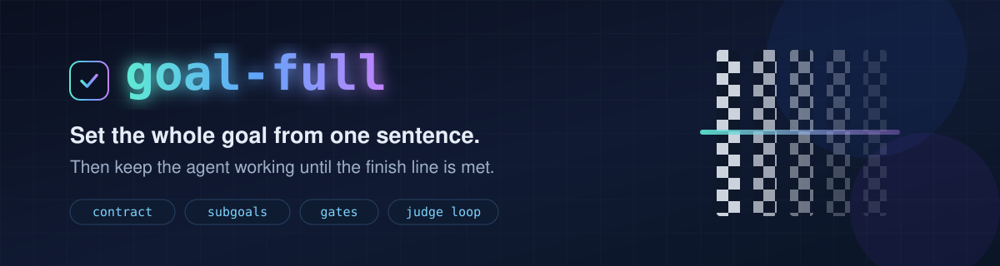
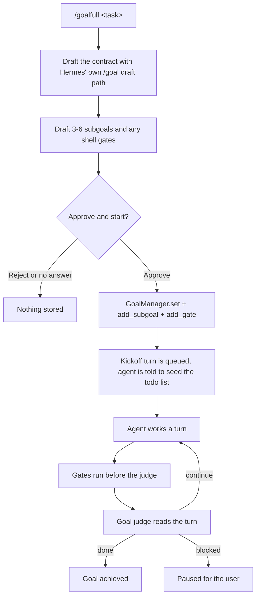
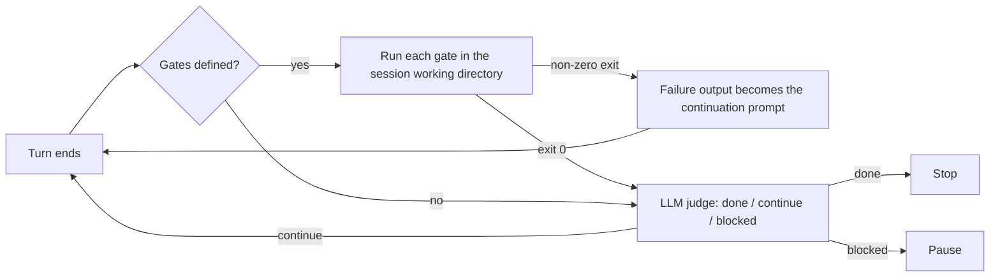
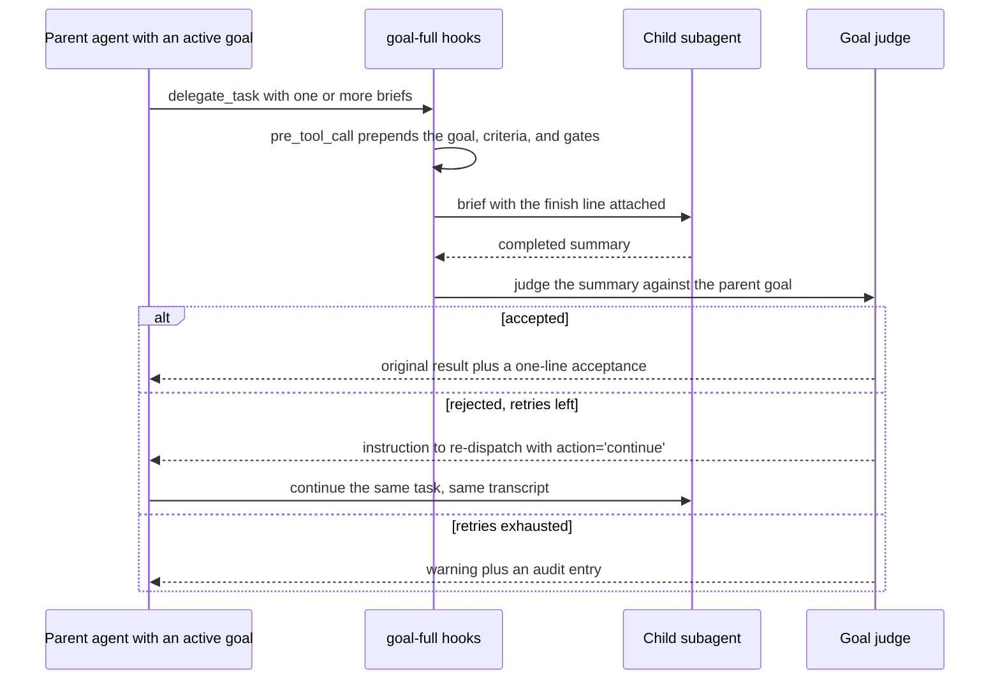

<div align="center">
  
</div>

<h1 align="center">goal-full</h1>

<p align="center">
  A Hermes Agent plugin that turns one sentence into a complete goal: contract, subgoals, and shell gates.
  It shows you the plan, stores it only after you approve, and keeps the finish line in front of the agent
  while it works, including when it delegates.
</p>

<p align="center">
  <a href="LICENSE"></a>
  
  
</p>

---

Hermes already has a goal engine: `/goal` keeps a standing objective alive across turns, an auxiliary
judge checks each turn, and `/goal gate add` makes a shell command part of the definition of done. What
it does not have is a fast way to set the whole thing up, or a way for the agent to grow the goal while
it works without quietly lowering the bar.

goal-full adds both. `/goalfull <task>` drafts the five-field completion contract, 3 to 6 ordered
subgoals, and the shell gates the task implies, then stops and asks. Approve it and the goal is stored
in Hermes' native goal storage and the loop starts. The agent gets a `goal_update` tool so it can start a
goal on a big request, add criteria it discovers mid-run, and propose removals that a judge has to
approve. Two hooks carry the finish line into `delegate_task` briefs and judge what comes back.

Nothing here replaces Hermes' goal engine. It writes through the same `GoalManager` calls that `/goal`,
`/subgoal`, and `/goal gate` use, so `/goal show`, `/goal pause`, and the built-in judge keep working.

## Contents

- [Why](#why)
- [How it works](#how-it-works)
- [Features](#features)
- [Install](#install)
- [Quick start](#quick-start)
- [Usage](#usage)
  - [`/goalfull`](#goalfull)
  - [`goal_update`](#goal_update)
- [Configuration](#configuration)
- [Let the agent start goals by itself](#let-the-agent-start-goals-by-itself)
- [Safety model](#safety-model)
- [Theory](#theory)
- [How it compares](#how-it-compares)
- [Limitations and compatibility](#limitations-and-compatibility)
- [FAQ](#faq)
- [Roadmap](#roadmap)
- [Contributing](#contributing)
- [License](#license)

## Why

Long agent runs fail in two directions.

The first is stopping early. The agent writes a plausible summary, calls the task done, and leaves the
hard part untouched. This gets worse when a strong model plans the work and cheaper models execute it:
the planner writes a careful brief, the executor returns something that reads like success, and nobody
checks. The failure is not a crash. It is a confident paragraph.

The second is moving the target. Ask an agent to satisfy a checklist and, sooner or later, it finds the
cheapest way to make the checklist true. It deletes the failing test, weakens the assertion, or rewrites
the criterion to describe what it already built. This is specification gaming, and it is old: the
DeepMind collection has around 60 documented examples of agents satisfying the literal objective without
the intended outcome ([Krakovna et al., 2020](https://deepmind.google/discover/blog/specification-gaming-the-flip-side-of-ai-ingenuity/)).
Goodhart's law says the same thing in one line: when a measure becomes a target, it stops being a good
measure ([Wikipedia](https://en.wikipedia.org/wiki/Goodhart%27s_law)).

The usual fixes are to write a better prompt or to loop forever. Neither is enough. A prompt is not a
contract, and a loop with no finish line just produces more confident paragraphs. What works is a
written finish line that the agent cannot quietly edit, plus a check that runs against the actual
artifact. goal-full makes that the default path and keeps a human in the loop at the one point where
it matters: before the goal is stored.

## How it works

### The goal lifecycle



The draft is written against a throwaway `GoalManager` with a suffixed session id. If you reject the
plan, nothing reaches your session. If you approve it, the contract that was shown is the contract that
is stored. There is no second model call between approval and storage that could change it.

### Gates, then the judge



Gates are the part a model cannot argue with. A test suite, a build, or a linter either exits 0 or it
does not. When a gate fails, its output goes back to the agent as the reason to keep going, so the next
turn works against the real error instead of a summary of it.

### Delegation carries the finish line



A subagent does not see the parent's goal. Without this, the parent can set a careful finish line and
then hand the actual work to a child that has never heard of it. The hook closes that gap. It fails
open, so a storage error never blocks delegation, and the re-dispatch cap stops a judge disagreement
from becoming an infinite ping-pong.

## Features

- One command writes the whole goal: contract, 3 to 6 subgoals, and the gates the task implies.
- Review before storage. Reject and nothing is written.
- Uses Hermes' native goal storage, so every built-in `/goal` command still works on the result.
- Adds the approved steps to the kickoff with an instruction to seed the todo list.
- `goal_update` lets the agent start a goal on a large request, add criteria, and add gates mid-run.
- Removals and edits go through a judge that defaults to reject, with per-goal caps and an audit log.
- `pre_tool_call` appends the finish line to every `delegate_task` brief.
- `transform_tool_result` judges completed subagent summaries and asks for a re-dispatch when they fall
  short, at most twice per delegation.
- Both hooks do nothing when no goal is active.
- No core edits. The plugin uses the public goal API and the plugin host.

## Install

Requirements: Hermes Agent 0.23 or newer. The plugin is tested on 0.23.2 and 0.23.3.

```bash
hermes plugins install AlejandroAkbal/hermes-goal-full --enable
```

The repository root is the plugin, so no subdirectory is needed. Restart the gateway after installing
so it loads the new code:

```bash
hermes gateway restart
```

If you run the gateway as a service, stop and start it the way you normally manage that service. A
running gateway keeps the plugin code it loaded at startup.

Manual install, if you prefer a checkout. Clone the repository somewhere, then copy it into the
plugins directory under the plugin's name:

```bash
git clone <this repository> ~/src/hermes-goal-full
cp -R ~/src/hermes-goal-full ~/.hermes/plugins/hermes-goal-full
hermes plugins enable goal-full
```

Check that Hermes sees it:

```bash
hermes plugins list
hermes plugins show goal-full
```

## Quick start

```text
/goalfull make the settings page remember the last selected workspace, and add a test for it
```

Hermes drafts something like this and waits:

```text
This is the goal that would be set. Nothing is stored until you approve it.

Goal set: make the settings page remember the last selected workspace, and add a test for it

Outcome: the settings page reopens with the last selected workspace
Verification: the workspace persists after reload and a test covers the selection
Constraints: do not change unrelated settings
Boundaries: settings UI and its tests
Stop when: the change needs a data migration

Subgoals:
  1. Find where the workspace selection is stored
  2. Persist the selection across reloads
  3. Add a test for the persisted selection

Gates:
  $ pytest tests/test_settings.py -q
```

Pick **Approve and start**. The goal is stored and the kickoff turn begins. The kickoff includes the
three steps and tells the agent to write them to the todo list. Pick **Reject, store nothing** and the session is untouched.

## Usage

### `/goalfull`

```text
/goalfull <what should be true when this is done>
```

The argument is the objective, not a plan. Write it the way you would describe done to a colleague.
The drafting model expands it into the contract and proposes steps and gates. You review.

Rules the draft follows:

- Subgoals are short steps in the order they can be done, each naming the concrete thing it produces.
- A gate is included only when the objective names something a command can check, such as a test, a
  build, or a lint. The model is told never to invent a command the objective does not imply.
- If the drafting model is unavailable, the goal is still set as a free-form goal with no contract.
  You get a note saying so.

Good objectives:

```text
/goalfull fix every failing test under tests/api and make sure the suite exits 0
/goalfull add CSV export to the reports page, including a header row and a test
/goalfull port the retry logic from the old client to the new one without changing its public API
```

Weak objectives:

```text
/goalfull improve the codebase
/goalfull make it better
```

Those are not checkable. The draft will be vague because the input is vague.

### `goal_update`

The plugin registers one tool, `goal_update`, in the `goal` toolset. You normally do not call it
yourself. The agent calls it when it decides a request is big enough to need a goal, or when it
discovers work the approved plan missed.

| Action | What it does |
| --- | --- |
| `start` | Drafts and stores a goal with no approval prompt. Refuses if a goal is already active. |
| `add_criterion` | Adds one acceptance criterion. Duplicates are ignored. Cap: 10. |
| `add_gate` | Adds one shell gate. Timeout is clamped to 120 seconds. Cap: 6. |
| `show` | Returns the goal, contract, criteria, and gates. |
| `remove_criterion` | Proposes removing a criterion. Requires `index` and `reason`; the judge must approve. |
| `remove_gate` | Proposes removing a gate. Requires `index` and `reason`; the judge must approve. |
| `edit_criterion` | Proposes replacing a criterion. Requires `index`, `new_text`, and `reason`. |

Examples of the arguments the agent sends:

```json
{"action": "start", "objective": "Add CSV export to the reports page", "max_turns": 12}
```

```json
{"action": "add_criterion", "text": "The export includes a header row"}
```

```json
{"action": "add_gate", "command": "pytest tests/test_reports.py -q", "timeout_seconds": 90}
```

```json
{"action": "remove_criterion", "index": 2, "reason": "the endpoint this step covered was removed in the same change"}
```

An agent-started goal defaults to 10 turns. That is deliberately small: the agent can start a goal
without asking, so the budget bounds what it can spend before you notice. Pass `max_turns` to change it
for one goal, or set `goalfull.agent_started_max_turns` for all of them.

`start` never replaces an active goal. If one is running, it returns the current goal and budget and
tells the agent to extend it with `add_criterion` or `add_gate`.

## Configuration

goal-full reads an optional `goalfull` section from your Hermes `config.yaml`. Every key is optional.
Missing or malformed values fall back to the default; a bad config never raises.

```yaml
goalfull:
  agent_started_max_turns: 10
  require_approval: false
  max_removals_per_goal: 3
  max_edits_per_goal: 3
  delegation_judge_retries: 2
```

| Key | Default | Meaning |
| --- | --- | --- |
| `agent_started_max_turns` | `10` | Turn budget for a goal the agent starts with `goal_update`. |
| `require_approval` | `false` | Reserved. Read today, not enforced; agent-started goals do not prompt. |
| `max_removals_per_goal` | `3` | Judged removals allowed per goal. |
| `max_edits_per_goal` | `3` | Judged criterion edits allowed per goal. |
| `delegation_judge_retries` | `2` | Re-dispatches allowed after a rejected subagent summary, per delegation. |

The judge model is not configured here. goal-full uses Hermes' `goal_judge` auxiliary, the same one
`/goal` uses:

```yaml
auxiliary:
  goal_judge:
    provider: your-provider
    model: your-judge-model
    timeout: 30
    max_tokens: 4096
```

Use a model that is good at reading instructions and returning strict JSON. The plugin asks for a
single JSON object and treats a malformed reply as a rejection.

Counters and audit records live under `$HERMES_HOME/state/goalfull/`:

```text
<session>-<hash>.json   per-goal counters
audit.jsonl             append-only decision log
```

Deleting those files resets the counters. The goal itself lives in Hermes' session store, not here.

## Let the agent start goals by itself

The tool description already tells the agent when to start a goal: a request with roughly 3 or more
distinct steps, multiple files, an expected 5 or more tool calls, or work that will run long. If you
want that policy to be stronger, put it in your `SOUL.md`:

```markdown
## Goals

- For a request with three or more distinct steps, multiple files, or an expected five or more tool
  calls, call `goal_update` with action `start` before doing the work.
- Write the objective as the condition that will be true when the work is done, not as a to-do item.
- Never start a goal when one is already active. Extend it with `add_criterion` or `add_gate`.
- Add a gate when the task names something a command can check. Do not invent commands.
- When you discover work the approved plan missed, add a criterion or a gate. Do not silently skip it.
- Do not remove or edit a criterion to make the goal easier. If a criterion is wrong, propose the
  change with a reason and let the judge decide. If it is rejected, tell the user which command to run.
- When you delegate, assume the child cannot see the goal. The finish line is attached to the brief;
  keep it there and judge the result against it.
```

Keep it short. A long policy competes with the actual task for attention.

## Safety model

The design assumes the agent will sometimes try to finish early. The controls are arranged so the
cheap path is the honest one.

**Adding is free.** The agent can add criteria and gates without approval. Adding work never weakens
the finish line, and blocking it would make the agent hide discovered work instead of recording it.
Caps of 10 criteria and 6 gates keep the goal readable.

**Removing is judged and fail-closed.** `remove_criterion`, `remove_gate`, and `edit_criterion` require
a reason. The goal judge sees the goal, the contract, the current criteria and gates, the proposed
change, the agent's reason, and the last verdict. It is told to approve only when the item is
redundant, wrong, impossible, or out of scope, and to reject when in doubt. A timeout, a transport
error, an empty reply, or malformed JSON is a rejection. The change does not happen.

**Caps bound persistence.** Three removals and three edits per goal. The counters are tied to the
goal's creation time, so a new goal starts clean. Every attempt, approved or rejected, is appended to
`audit.jsonl`.

**The user keeps an unjudged path.** `/subgoal remove N`, `/goal gate remove N`, `/goal gate clear`,
and `/goal clear` are yours. The agent is told to point you there instead of arguing with the judge.

**Hooks fail open, judges fail closed.** A broken `pre_tool_call` hook sends the delegation brief
unchanged. A broken `transform_tool_result` hook returns the original result. The reasoning: delegation
should not break because the plugin cannot read a sidecar. The worst case is the behaviour you had
before installing. The removal judge is the opposite, because there the failure mode is an agent
lowering its own bar.

**Gates are not a sandbox.** They run as shell commands in the session's working directory with your
permissions. Only add gates you would run yourself, and read a drafted gate before you approve it.

## Theory

The plugin is a small system built on ideas that are well documented elsewhere. These are the ones that
shaped the design, with sources.

**LLM as a judge.** Using a strong model to grade another model's output is now standard, and the
known biases are real: position, verbosity, and self-enhancement. Zheng et al. measured agreement with
human preferences and documented those failure modes in
[Judging LLM-as-a-Judge with MT-Bench and Chatbot Arena](https://arxiv.org/abs/2306.05685) (2023).
goal-full uses the judge for a narrow question with a fixed output schema, and pairs it with shell
gates wherever a command can decide. That is the practical mitigation: do not ask a judge to do a
compiler's job.

**Iterate with feedback, not with hope.** Reflexion showed that language agents improve when they
reflect on feedback and keep that reflection for the next attempt
([Shinn et al., 2023](https://arxiv.org/abs/2303.11366)). Self-Refine showed the same loop with the
model's own feedback ([Madaan et al., 2023](https://arxiv.org/abs/2303.17651)). Hermes' goal loop is a
concrete version of this: the judge's reason becomes the next turn's prompt. goal-full's contribution
is making the feedback target a written contract instead of a vague objective.

**Process beats outcome when the outcome is hard to check.** Lightman et al. found that rewarding each
reasoning step can beat rewarding only the final answer
([Let's Verify Step by Step](https://arxiv.org/abs/2305.20050), 2023). The analogy here is mechanical:
a gate that checks an intermediate artifact (tests pass, build succeeds) gives the loop a denser signal
than a judge reading a summary.

**Specification gaming and Goodhart.** Krakovna et al. describe specification gaming as behaviour that
satisfies the literal objective without the intended outcome, with around 60 examples
([DeepMind, 2020](https://deepmind.google/discover/blog/specification-gaming-the-flip-side-of-ai-ingenuity/)).
Goodhart's law is the older, more general statement
([Wikipedia](https://en.wikipedia.org/wiki/Goodhart%27s_law)). This is why removals are judged, why
the judge prompt says "when in doubt, reject", and why gates are preferred over prose when a command
can decide.

**The loop itself.** Hermes' `/goal` is explicitly a take on the Ralph loop, inspired by Codex CLI's
`/goal` ([Hermes goals docs](https://hermes-agent.nousresearch.com/docs/user-guide/features/goals)).
Ralph, in its purest form, is a shell loop that feeds the same prompt to an agent until the work is
done ([Huntley](https://ghuntley.com/ralph/)). A loop is necessary but not sufficient. Without a finish
line it is just repetition.

## How it compares

The table separates tools that implement a goal loop from tools that help you write one, and from
general agent frameworks where you would build the loop yourself. Only claims supported by the linked
documentation are listed. Where a project's docs do not say, the cell says so.

| Project | What it is | Goal contract | Shell gates | Review before start | Agent can grow the goal | Judged removal | Delegation finish line |
| --- | --- | --- | --- | --- | --- | --- | --- |
| **goal-full** | Hermes plugin | Drafts all five fields | Drafts and adds them | Yes, approve or reject | Yes, via `goal_update` | Yes, judge plus caps | Yes, both hooks |
| **Hermes `/goal`** | Built-in | `/goal draft` writes the contract | `/goal gate add` | No, it starts on set | `/subgoal` from the user | No, the user removes | No |
| **evey-goals** | Hermes plugin | None; goals live in a markdown file | No | No | Yes, through its own tool | No | No |
| **Goals dashboard** | Hermes dashboard plugin | None; reads existing goal rows | No | No | No | No | No |
| **north-star** | Hermes skill | Interviews you into a finish line | Yes, deterministic checks | Yes, it interviews first | No | No, a separate judge decides | No |
| **Claude Code** | CLI agent | No built-in contract | Via `Stop` hooks you write | N/A | N/A | N/A | Subagents exist; no goal judge |
| **OpenAI Codex CLI** | CLI agent | `/goal` in 0.128.0, per Hermes docs | No built-in gate command | N/A | N/A | N/A | Subagents exist; no goal judge |
| **Ralph loop** | Technique | The prompt file is the contract | Whatever the prompt runs | No | No | No | No |
| **AutoGPT** | Agent platform | Task brief | No built-in gate | No | Limited | No | No |
| **BabyAGI** | Experimental agent framework | Task list | No | No | Yes, it creates tasks | No | No |
| **OpenHands** | Autonomous SWE agent | Task prompt | Runs tests as tools | No | Via the agent | No | No |
| **Aider** | Pair programming CLI | No | No | No | No | No | No |
| **Cursor Cloud Agents** | Cloud agents | Task prompt | Runs commands in a VM | No | Via the agent | No | No |
| **Devin** | Autonomous SWE agent | Task prompt | Runs tests | No | Via the agent | No | No |
| **LangGraph** | Orchestration framework | You build it | You build it | You build it | You build it | You build it | You build it |
| **CrewAI** | Multi-agent framework | You build it | You build it | You build it | You build it | You build it | You build it |

Notes on the Hermes-adjacent projects, which are the closest comparisons:

- **evey-goals** is a plugin that stores goals in a `goals.md` file and exposes a tool to list, add,
  complete, and remove them. It is a goal list, not a goal loop, and it does not use Hermes' judge.
- **Goals dashboard** (the Goals plugin in `dzianisv/hermes-plugins`) is a read-only dashboard over the
  goal rows Hermes already writes. It helps you see goals across sessions; it does not set or judge
  them.
- **north-star** is a skill that interviews the owner, writes a finish line, and delegates the fuzzy
  part to a separate judge service. It is the closest in spirit to goal-full's review step. The
  difference is integration: goal-full writes into Hermes' own goal storage, so the built-in loop and
  judge apply, and the agent can extend the goal from inside a turn.

For the general tools, the honest summary is that they are agents, not goal systems. Claude Code's
hooks can implement a stop gate if you write one ([hooks reference](https://code.claude.com/docs/en/hooks)).
Codex CLI has a non-interactive mode for scripts ([Codex CLI docs](https://developers.openai.com/codex/cli/)).
AutoGPT today presents itself as a platform of specialized agents
([README](https://github.com/Significant-Gravitas/AutoGPT)). BabyAGI's original task-planning agent is
archived; the current repo is an experimental self-building framework
([README](https://github.com/yoheinakajima/babyagi)). OpenHands is an autonomous software engineer with
a CLI and a newer Agent Canvas ([docs](https://docs.openhands.dev/openhands/usage/cli/terminal)).
Aider is a terminal pair programmer ([README](https://github.com/Aider-AI/aider)). Cursor's Cloud Agents
(formerly Background Agents) run in their own VMs in parallel
([docs](https://cursor.com/docs/cloud-agent)). Devin is a hosted autonomous software engineer
([docs](https://docs.devin.ai/get-started/devin-intro)). LangGraph is a low-level orchestration
framework for stateful agents ([README](https://github.com/langchain-ai/langgraph)); CrewAI is a
multi-agent orchestration framework ([README](https://github.com/crewAIInc/crewAI)). All of them can
run a goal-shaped task. None of them, as documented, ships a completion contract that a judge enforces
with judged mutation and a delegation finish line.

## Limitations and compatibility

**Private imports.** goal-full imports `agent.auxiliary_client.call_llm`, internals from
`hermes_cli.goals` (`GoalManager`, `draft_contract`, `judge_goal`, `goal_kick_prompt`,
`_call_goal_judge_llm`, `_goal_judge_timeout`), and `hermes_cli.goal_command.dispatch_goal_command`.
Those are not a stable public API. A Hermes release that renames or moves them can break the plugin.
The plugin is version-sensitive by design: it chose integration with the real goal engine over
reimplementing one.

**Tested versions.** 0.23.2 and 0.23.3. The manifest declares `requires_hermes: ">=0.23"`. Older
versions are untested. Newer versions may work and may not; if a private symbol moves, the import fails
at use time rather than at install time.

**Gates run in the session working directory.** A gate is a shell command with your permissions. It is
not sandboxed. Read drafted gates before approving, and do not add a gate that touches data you would
not let the agent touch.

**Judge latency and timeouts.** Every judged removal and every delegation check is a model call. The
default timeout comes from `auxiliary.goal_judge.timeout` (30 seconds in Hermes). A slow judge means a
slow removal. A timed-out judge means a rejection, by design.

**Classic CLI caching.** The in-process classic CLI caches one `GoalManager` per session. A mid-turn
`goal_update` write can be overwritten by that cached manager's next save. The gateway, Desktop, and TUI
build a manager per action and do not have this problem. Desktop is the supported path for
agent-started goals and judged edits. `/goalfull` itself is safe everywhere because it writes through
the command handler.

**Background delegations are not judged.** `transform_tool_result` only inspects blocking
`delegate_task` results with completed summaries. A dispatched or background delegation returns an
acknowledgement and is skipped, because there is no summary to judge yet.

**The judge can be wrong.** It is a model reading a summary. Gates reduce the surface where that
matters, but they do not eliminate it. Treat the audit log as evidence, not as proof.

## FAQ

**Does this replace `/goal`?**
No. It writes goals through the same storage. `/goal show`, `/goal pause`, `/goal clear`, `/subgoal`,
and `/goal gate` all work on a goal created by `/goalfull`.

**What happens if I reject the draft?**
Nothing is stored. The draft was written to a throwaway manager, and the real session is untouched.

**Can the agent set a goal without asking me?**
Yes, if it decides a request is big enough, and only when no goal is active. The default budget is 10
turns. Set `goalfull.agent_started_max_turns` lower if you want a tighter leash. `require_approval` is
reserved and does not currently change this.

**Can the agent delete a criterion to make the goal easier?**
It can propose one. A judge has to approve, it has three removals and three edits per goal, and every
attempt is logged. You can always remove one yourself with `/subgoal remove N`.

**Why not just put the finish line in the prompt?**
A prompt is not durable. It gets summarized, compacted, or dropped when work is delegated. The stored
goal is read by the loop and by the hooks on every turn.

**Why do hooks fail open?**
Because delegation breaking is worse than a weak summary getting through. The removal judge fails
closed for the opposite reason: there, the failure mode is the agent lowering its own bar.

**Does it work on the Desktop app?**
Yes, and Desktop is the recommended surface for agent-started goals and judged edits. `/goalfull`
works on every surface that can show a choice prompt.

**Does it work with a local model as the judge?**
It works with whatever `auxiliary.goal_judge` points at. A small model that cannot return strict JSON
will cause rejections, which is safe but annoying. Use a model that follows a one-line JSON schema.

**How do I see what the judge decided?**
`/goal show` for the current state, and `audit.jsonl` under `$HERMES_HOME/state/goalfull/` for every
removal, edit, and delegation verdict.

**Is my data sent anywhere?**
Only to the model provider you configured for Hermes and its `goal_judge` auxiliary. The plugin adds no
network calls of its own.

## Roadmap

- Keep up with Hermes releases and replace private imports when a public equivalent appears.
- Optional approval mode for agent-started goals, if Hermes exposes a clean prompt path for tools.
- Per-criterion status, if `GoalState` ever supports it without a fork.
- A dry-run mode that shows the drafted plan without storing it, for scripted use.
- More tests around judge parsing and hook edge cases.

Nothing on this list is promised. The plugin is small on purpose.

## Contributing

Bug reports and pull requests are welcome. Read [CONTRIBUTING.md](CONTRIBUTING.md) first. The short
version: keep the plugin's behaviour identical unless the change is the point, add a test, and run the
suite against a real Hermes checkout.

Security issues: see [SECURITY.md](SECURITY.md). Please do not open a public issue for a vulnerability.

## License

MIT. See [LICENSE](LICENSE).

goal-full is an independent project. It is not an official Nous Research product.
